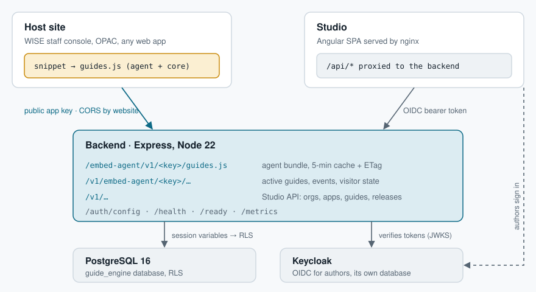
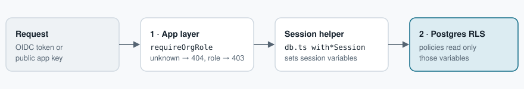
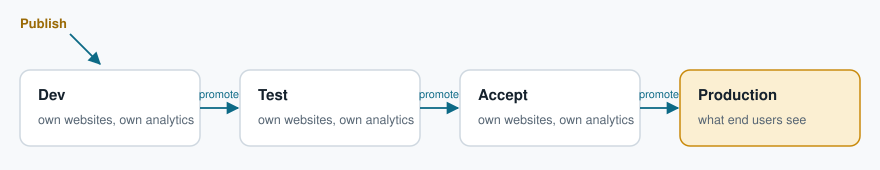
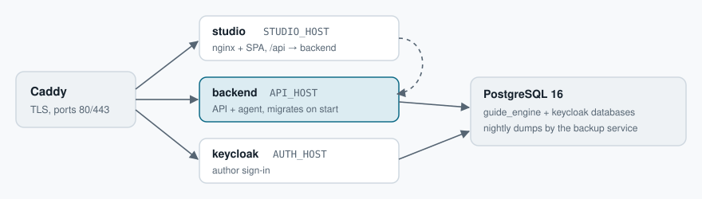

# Architecture overview

A one-page tour of how Guide Engine fits together, with diagrams. For the full walk-through
(every RLS policy, the boot sequence, the who-can-do-what matrix and the known gaps) read
[How Guide Engine is built](architecture.md).

Guide Engine shows in-app guides (tooltips, modals, banners, tours and a help center) on any
website from one install snippet. Authors write guides in the **Studio**; a small **agent** on each
page asks the **backend** which guides apply and shows them.

## The pieces

| Piece | Where | What it does |
|---|---|---|
| Agent | `packages/agent` | The browser side: the framework-agnostic engine (`src/engine`: picks guides, follows navigation, draws cards in a Shadow DOM, runs the help center) and the snippet runtime, bundled into one IIFE served as `guides.js`. Nothing is published to npm. |
| Backend | `apps/backend` | Express on Node 22: the public agent API, the Studio API, auth, releases, analytics, operator scripts. |
| Studio | `apps/studio` | Angular 21 authoring app behind nginx: guides, saved pages, environments, members, analytics. |
| Database | PostgreSQL 16 | The only store. Row-level security on every tenant table; rate limits and retention live here too. |
| Sign-in | Keycloak | OIDC identity for Studio authors only. Organizations and roles stay in Guide Engine's own tables. |

## The system at runtime

There are two ways in, and the backend treats them differently: an anonymous **agent surface**
keyed by a public app key, and an authenticated **Studio surface** for authors.



| Surface | Who calls it | Identity | Database session |
|---|---|---|---|
| Agent API | Visitors' browsers on the app's websites | Public app key; optional server-signed visitor JWT (per-app secret) | `withAgentSession` |
| Studio API | The Studio, same-origin through `/api` | Keycloak OIDC token; org-wide role from Guide Engine's tables | `withStudioSession` |
| Platform | Guide Engine's own admins | `studio_user.platform_admin` | `withPlatformSession` (metadata only, never guide content) |
| Support | A platform admin, while the org owner allows it | Owner sets `support_access_until` (≤ 90 days) | `withSupportSession` (read-only, every request logged) |

## Repository layout

An npm workspaces monorepo. `npm run build` builds every workspace; TypeScript
runs in strict mode everywhere from `tsconfig.base.json`.

```text
packages/
  agent/                 the browser side, bundled into guides.js
    src/engine/engine.ts         state machine: fetch → match route → wait for anchor → show → complete
    src/engine/dom-renderer.ts   cards in a Shadow DOM beside [data-guide-id] anchors
    src/engine/help-widget.ts    floating Help button and searchable guide list
    src/engine/theme.ts          app colours, or follow the site's Bootstrap theme
    src/index.ts                 window.guideEngine, queue replay, SPA navigation hooks
    build.mjs                    esbuild → one minified IIFE (guides.js)
apps/
  backend/               Express + Postgres API
    migrations/            001_schema.sql (schema + RLS) and numbered deltas
    src/app.ts             middleware order, routers, central error handler
    src/db.ts              with*Session helpers: one transaction, RLS variables set
    src/auth/              oidc.ts, studio.ts, visitor.ts (signed identity)
    src/routes/agent.ts    guides.js and /v1/agent/:key/*
    src/routes/studio/     context.ts (role checks), orgs, members, guides, pages,
                           environments, analytics, visitors, errors, platform
    src/services/          environments, versions, orgs, lifecycle
    src/scripts/           seed, mint-token, sign-identity, retention, encrypt-secrets
  studio/                Angular 21, zoneless, signals
    src/app/core/          api.service, auth.service (oidc-client-ts), interceptor, guard
    src/app/pages/         guide-list, guide-editor, pages, app-settings, members, operator…
    src/app/components/    environments, releases, analytics, version-history
    nginx.conf.template    serves the SPA, proxies /api/* to the backend
  demo/                  a Vite page that installs the snippet, for local testing
e2e/                     Playwright: sign in → org and app → publish → snippet shows it
deploy/                  production stack: compose, Caddyfile, backups, monitoring
docker/                  local dev: docker-compose.yml (Postgres :5433, Keycloak :8081), init.sql, realm
docs/                    architecture, DevOps, signed identity, WISE, legal templates
```

## Data model

Defined in `apps/backend/migrations/001_schema.sql`. An **organization** owns
**applications**; everyone in it has one role (viewer < editor < manager < owner) for all of its
apps.

| Area | Tables | Holds |
|---|---|---|
| Tenancy | `organization`, `org_member`, `invitation`, `studio_user` | Customers, people, their one org-wide role |
| Apps | `application`, `app_environment`, `app_page` | Websites with a public key, release stages that own origins, named URL rules |
| Content | `guide`, `guide_version` | Guides with immutable published versions; their steps (JSON) point at `data-guide-id` anchors |
| Releases | `guide_release`, `guide_release_event` | Which version is live in which environment, with an append-only history |
| Runtime | `guide_event`, `user_guide_state`, `agent_error` | Analytics, per-visitor show-once and progress state, agent exceptions |
| Platform | `system_config`, `support_access_log`, `agent_rate_limit` | Global kill switch, support audit trail, rate-limit counters |
| View | `active_guide` | What the agent may serve: released, enabled, in date range, route resolved through the saved page |

## Isolation, enforced twice

No org, app or user id is ever taken from request input. The application checks access first,
then Postgres checks it again on every row.



Destructive app actions (delete, key rotation, forget a visitor) also need a manager, both in the
routes (`requireAppManager`) and in the database (`app.manager_app_ids` and a trigger on the key
columns). Step content is sanitized on the server.

## Two flows

**A visitor sees a guide**

1. The snippet queues calls on `window.guideEngine` and loads `guides.js` asynchronously.
2. The backend checks the request Origin against the app's websites (CORS). The origin also
   selects the environment.
3. The agent asks for active guides; `withAgentSession` reads `active_guide` and filters by the app
   switch, the kill switch, `enabled`, the account allowlist, visitor tags and show-once state.
4. The engine matches the route, waits for the `data-guide-id` anchor and shows the steps.
5. Events are sent in batches, unless analytics is off for that environment. Any failure shows
   nothing and never touches the host page.

**An author publishes**

1. The author signs in to Keycloak (OIDC with PKCE); the Studio keeps the token.
2. The interceptor adds it to `/api/v1/*`; nginx proxies to the backend, which verifies it against
   Keycloak's keys.
3. Saving makes a draft. Publishing creates an immutable `guide_version` and releases it to the
   first environment.
4. Promote, revert and withdraw move `guide_release` rows and append to `guide_release_event`.
5. Preview links carry a short-lived signed token, so a version can be checked on the real site
   before release.

## Environments are release stages

Each app's environments run in promotion order, and the last one is production. Each owns its
websites, so the agent picks the environment from the request Origin. Show-once state and
analytics are kept per environment and never mixed.



Revert puts a stage's previous version back; withdraw removes it; every move is appended to
`guide_release_event`. `guide.current_version_id` mirrors production. Each stage has an analytics
switch (off: no events; visitor state is still kept). Stage names are the app's own: the WISE staff
console runs local → dev → test, which makes "test" its production.

## The install snippet

The backend generates it (`installSnippet()` in `apps/backend/src/services/orgs.ts`) with the
app's public key and `PUBLIC_API_URL`, and the Studio shows it under **Install & settings**. It
loads asynchronously and queues calls until the agent arrives.

```html
<script>
(function(w,d,k){var g=w.guideEngine=w.guideEngine||{_q:[]};
['initialize','identify','openHelp','closeHelp','toggleHelp'].forEach(function(m){g[m]=g[m]||function(){g._q.push([m].concat([].slice.call(arguments)))}});
var s=d.createElement('script');s.async=1;s.src='https://guides.example.com/agent/v1/'+k+'/guides.js';d.head.appendChild(s);
})(window,document,'ge_pk_…');
guideEngine.initialize({
  visitor: { id: 'USER_ID' },      // your signed-in user's id
  account: { id: 'ACCOUNT_ID' }    // optional: their company / customer id
  // helpButton: false             // hide the floating help button (call guideEngine.openHelp() from your own)
});
</script>
```

The five stubbed methods are exactly the agent's API. With **Require signed identity** on, pass
`jwt` to `initialize`; ids and tags then come from the token only. Full setup:
[Installing Guide Engine on a website](install.md#installing-guide-engine-on-a-website).

## Build, test and deploy



`deploy/` runs this on one host with Docker Compose; an optional monitoring profile adds
Prometheus and Alertmanager with the rules in `deploy/monitoring/`. Operating it:
[Deploying and operating](operations.md).

| Step | How |
|---|---|
| Build | `npm run build`: the agent via esbuild, the Studio via the Angular builder |
| Test | backend: vitest + supertest on a real Postgres · agent (engine + runtime): vitest + jsdom · Studio: Angular unit tests · e2e: Playwright against the full stack |
| Images | `backend` (API + agent bundle) and `studio` (nginx + SPA) |
| CI | GitHub Actions: build, tests, e2e, images to ghcr.io and the docs site |

## Ground rules

- Postgres is the only store: no queues, caches or analytics warehouse. Rate limits count in
  Postgres too.
- Targeting stays simple: the `enabled` flag, app and global switches, an account allowlist and
  visitor tags. No attribute-rule segments.
- Guides point at `data-guide-id` attributes, never raw CSS selectors.
- Fail closed, fail silent: when anything can't be verified the agent shows nothing and never
  throws into the host page.
- The app key is public; real identity comes from the visitor ids the page passes, or a
  server-signed JWT when the app requires it.

## Read more

| Page | For |
|---|---|
| [Getting started](../README.md) | Running it locally, the repository, tests, known gaps |
| [Installing Guide Engine](install.md) | The snippet, `data-guide-id`, signed identity, how a guide is chosen, the help center |
| [Studio reference](../apps/studio/README.md) | Roles, authoring, environments and releases, saved pages, analytics |
| [Identity, roles and security](security.md) | Sign-in, protections, keys, your data, platform admins and support access |
| [Configuration and API reference](reference.md) | Every setting and endpoint, migrations |
| [Deploying and operating](operations.md) | First install, go-live checklist, everyday tasks, backups, monitoring, troubleshooting |
| [DevOps handoff](handoff-devops.md) | The first deployment: servers, decisions, settings, go-live steps |
| [How Guide Engine is built](architecture.md) | The full walk-through: every RLS policy, who can do what, known gaps |
| [Signed identity](integration/signed-identity.md) | The token contract for the backend that signs visitor identities |
| [WISE integration](wise/index.md) | Guide Engine in the WISE staff console and the OPAC |
